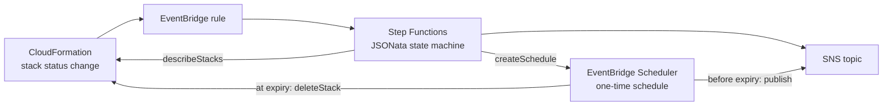

# stack-expiry

Tag a CloudFormation stack with `ttl=2h` and it deletes itself two hours later.

```bash
aws cloudformation deploy --stack-name my-experiment --template-file app.yaml --tags ttl=2h
```

That is the whole interface. It works the same for anything that deploys through CloudFormation: `sam deploy --tags ttl=2h`, `cdk deploy --tags ttl=2h`, or the console.

stack-expiry is one CloudFormation template with no Lambda functions, no containers, no build step and no pipeline. You deploy it once per account and Region.

## Why

Sandbox and demo stacks are easy to create and easy to forget. A NAT gateway or a database left running over a weekend costs more than the experiment was worth. Cleanup scripts that run on a timer have to guess which stacks are safe to remove. Here the person who creates the stack says how long it should live, at the moment they create it.

## Install

```bash
aws cloudformation deploy \
  --stack-name stack-expiry \
  --template-file template.yaml \
  --capabilities CAPABILITY_IAM \
  --parameter-overrides NotifyEmail=you@example.com
```

| Parameter | Default | Meaning |
|---|---|---|
| `TagKey` | `ttl` | The stack tag that holds the time to live. |
| `WarnMinutes` | `15` | A warning is sent this many minutes before deletion. |
| `NotifyEmail` | empty | Optional email subscription to the notification topic. |
| `DeletionPolicyArn` | `AdministratorAccess` | Managed policy for the role CloudFormation uses to delete expired stacks. |

## Use

| Tag value | Meaning |
|---|---|
| `ttl=30m` | 30 minutes |
| `ttl=2h` | 2 hours |
| `ttl=3d` | 3 days |

The value is a number from 1 to 9999 followed by `m`, `h` or `d`.

- **Renew:** every successful deploy of the stack restarts the timer. Deploy again with `ttl=8h` to change it.
- **Cancel:** deploy the stack without the tag. The schedule is removed.
- **Keep for good:** turn on termination protection, or remove the tag.
- **Try it:** `aws cloudformation deploy --stack-name demo --template-file examples/demo-stack.yaml --capabilities CAPABILITY_IAM --tags ttl=5m`

You get a message on the SNS topic when an expiry is set, a warning before deletion, a notice when a tag value is not valid, and a notice when a delete fails (for example, a bucket that is not empty).

No email handy? `./examples/inbox.sh setup` subscribes a queue to the topic, and `./examples/inbox.sh` prints the notices received so far.

## How it works



1. CloudFormation sends a status change event to the default EventBridge bus whenever a stack operation finishes. A rule matches `CREATE_COMPLETE`, `UPDATE_COMPLETE`, `DELETE_COMPLETE` and `DELETE_FAILED`.
2. The rule starts a Step Functions state machine. It calls `DescribeStacks` to read the stack's tags. The event itself does not carry them.
3. A JSONata expression parses the tag value and computes the expiry time. No Lambda function is involved.
4. The state machine creates two one-time schedules in EventBridge Scheduler. One calls `cloudformation:DeleteStack` directly through Scheduler's universal target. The other publishes the warning to SNS.
5. Schedules delete themselves after they run. If you delete the stack yourself, or remove the tag, the state machine removes them.

Nested stacks inherit their parent's tags. The state machine ignores them and schedules only the root stack.

## Safety

- The Scheduler role can call `DeleteStack` only on stacks that carry the tag. The IAM policy has a condition on `aws:ResourceTag/ttl`, so if the tag is removed, IAM refuses the delete even if a schedule still exists.
- The role that deletes resources can be assumed only by the CloudFormation service, and only the Scheduler role may pass it.
- `DeletionPolicyArn` defaults to `AdministratorAccess` because a stack can contain any resource type. If your temporary stacks use a known set of services, pass a narrower policy.
- A stack without the tag is never touched.

## Limits

- Times are relative to the last successful deploy, not to the first creation.
- If termination protection is on, the delete is refused and the stack stays. You will have received the warning, but there is no second notice.
- Only stack operations trigger a re-read of the tag. Changing the tag is itself a stack update, so this is normally invisible.
- Deploy once in each Region where you want it.

## Cost

Each stack operation uses about nine Step Functions state transitions and at most two Scheduler invocations. For a typical sandbox account this stays inside the free tier. Without the free tier, a thousand stack deploys cost about 25 cents.

## Remove

```bash
aws cloudformation delete-stack --stack-name stack-expiry
```

Pending schedules are deleted with the schedule group, so nothing is deleted after you remove it.

## License

MIT
